# 自定义 string：接口、实现与详细流程图

本文依据 [string/string.h](string.h) 与 [string/string.cpp](string.cpp) 编写，分析的是全局命名空间中的自定义 `string`，不是 `std::string`。`main.cpp` 不参与本文分析，也不参与默认构建。本文单独维护，不向 `README.md` 追加内容。

流程图使用 Mermaid：在支持 Mermaid 的 Markdown 预览器中可直接查看。各图描述**当前实际实现**；发现的问题单独注明，不能将图中的执行路径理解为已经修复后的算法。

## 目录

1. [目录与构建](#1-目录与构建)
2. [对象模型与约定](#2-对象模型与约定)
3. [接口速查](#3-接口速查)
4. [构造、拷贝、赋值与析构](#4-构造拷贝赋值与析构)
5. [访问与迭代器](#5-访问与迭代器)
6. [容量管理与尾部追加](#6-容量管理与尾部追加)
7. [插入](#7-插入)
8. [删除与清空](#8-删除与清空)
9. [查找与子串](#9-查找与子串)
10. [比较运算](#10-比较运算)
11. [流输入输出](#11-流输入输出)
12. [当前边界问题与使用限制](#12-当前边界问题与使用限制)

## 1. 目录与构建

```text
CPPString/
├── CMakeLists.txt             # C++20 静态库目标 CPPString
├── STRING_IMPLEMENTATION.md   # 本文
├── README.md                 # 原有学习文档
├── main.cpp                  # 保留原文件，默认构建排除
└── string/
    ├── string.h              # 类型、成员声明、getline 声明
    └── string.cpp            # 成员及非成员函数定义
```

项目实际使用 `CMakeLists.txt`，没有名为 `Make.txt` 的配置文件，因此本次同步修改 `CMakeLists.txt`。目标由可执行程序改为静态库，不需要入口函数。

在 `CPPString` 目录运行：

```powershell
cmake -S . -B build-string -G "MinGW Makefiles"
cmake --build build-string --target CPPString
```

需要 CMake 3.20 或以上版本及支持 C++20 的编译器。上述生成器用于 MinGW；使用其他工具链时按环境选择生成器。MinGW 构建产物为 `build-string/libCPPString.a`，不会生成或运行 `main.cpp` 对应的程序。已有 CLion 构建目录需要重新加载 CMake，旧目录中遗留的 exe 不是本次静态库构建产物。

其他 CMake 目标可通过 `target_link_libraries(调用方 PRIVATE CPPString)` 链接，并使用 `#include "string/string.h"`。公开包含路径为项目根目录，避免直接把 `string/` 加入搜索路径而让自定义 `string.h` 遮蔽系统同名头文件。

## 2. 对象模型与约定

| 成员或类型 | 含义 |
| --- | --- |
| `char* _str` | 对象独占的堆数组首地址 |
| `std::size_t _size` | 有效字符数量，不包含末尾终止符 |
| `std::size_t _capacity` | 可容纳的有效字符数量，不包含末尾终止符 |
| `static const size_t npos` | 实现中由 `-1` 转换为无符号 `size_t`，表示最大值；用于未找到、删除至末尾及截取至末尾 |
| `iterator` | `char*`，可修改字符 |
| `const_iterator` | `const char*`，只读访问字符 |

在有效调用且未触发实现缺陷时，活对象维持：

- `_size <= _capacity`。
- 分配的数组包含 `_capacity + 1` 个字符位置。
- `_str[_size] == '\0'`，即使空字符串也有一个终止符位置。
- 不同对象各自拥有内存；拷贝对象不会共享 `_str`。

例如 `_size = 3`、`_capacity = 6`：

```text
下标       0    1    2    3     4    5    6
内容      'a'  'b'  'c'  '\0'   ?    ?    ?
           └── 有效字符 ──┘      未使用容量
begin() -> 0             end() -> 3
```

`end()` 是尾后迭代器；遍历区间为 `[begin(), end())`。虽然尾后位置存放终止符，也不应作为有效字符解引用或修改。

调用关系总览（终止符的维护分散在具体修改函数中）：

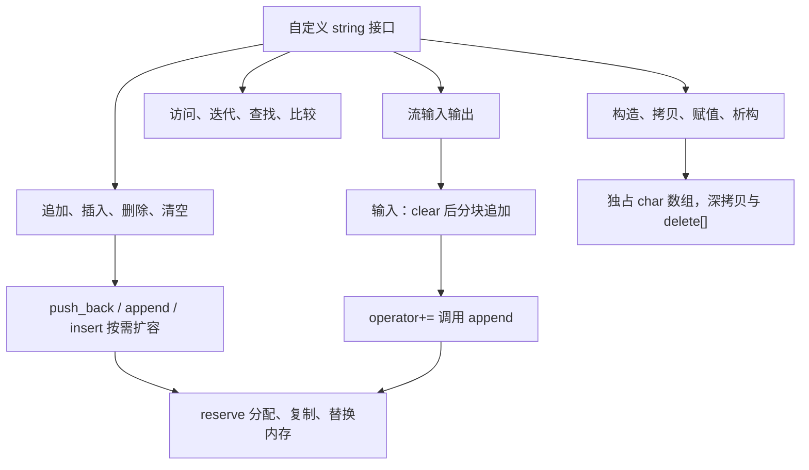

## 3. 接口速查

以下记 `n` 为当前长度、`m` 为输入 C 字符串长度、`k` 为实际截取长度；复杂度忽略分配器自身开销。字符串指针参数必须非空，并指向有效且以 `\0` 终止的数组。

| 接口 | 返回与用途 | 关键前提 / 当前行为 | 时间复杂度 |
| --- | --- | --- | --- |
| `string()` | 创建空对象 | 分配一个终止符 | O(1) |
| `explicit string(const char*)` | 从 C 字符串构造 | 不允许隐式转换；容量等于长度 | O(m) |
| `string(const string&)` | 深拷贝 | 新容量等于源长度，不复制备用容量 | O(源长度) |
| `operator=(const string&)` | 返回 `*this` | 自赋值直接返回；先分配再释放 | O(源长度)，自赋值 O(1) |
| `~string()` | 释放数组 | 使用 `delete[]` | 除释放开销外 O(1) |
| `c_str()` / `size()` | 只读地址 / 长度 | 没有公开 `capacity()` | O(1) |
| `operator[](i)` 的两个重载 | 字符引用 | `assert(i < _size)` | O(1) |
| `begin()` / `end()` 的 const 与非 const 重载 | 首地址 / 尾后地址 | const 对象返回只读指针 | O(1) |
| `reserve(n)` | 扩容，无返回值 | 仅增容，不缩容、不改变长度 | 不扩容 O(1)，扩容 O(当前长度) |
| `push_back(ch)` / `operator+=(ch)` | 尾插；后者返回 `*this` | 空容量先扩至 4，之后翻倍 | 均摊 O(1)，单次最坏 O(n) |
| `append(str)` / `operator+=(str)` | 尾部追加；后者返回 `*this` | 容量不足时取翻倍容量与所需长度较大者 | O(m)，扩容时 O(n+m) |
| `insert(pos, ch)` | 返回 `*this` | `assert(pos <= _size)` | O(n-pos)，扩容时 O(n) |
| `insert(pos, str)` | 返回 `*this` | 同上；存在下标回绕问题，见第 7、12 节 | 正常路径 O(n-pos+m)，扩容时 O(n+m) |
| `erase(pos=0, len=npos)` | 返回 `*this` | `assert(pos < _size)`，不接受尾后位置 | O(n-pos-len) 或截断 O(1) |
| `pop_back()` | 删除尾字符 | `assert(_size > 0)` | O(1) |
| `clear()` | 清空但保留容量 | 设置首字符为终止符 | O(1) |
| `find(ch, pos)` | 下标或 `npos` | `pos` 没有默认值；从指定位置扫描 | O(n-pos)，pos 大于等于长度时 O(1) |
| `find(str, pos)` | 下标或 `npos` | `pos` 没有默认值；调用 `strstr`，要求 pos 不超过长度 | 取决于库的 `strstr` 实现 |
| `substr(pos, len=npos)` | 独立的新对象 | 必须自行保证 `pos <= _size` | O(k)，未省略返回拷贝时仍为 O(k) |
| `< <= > >= == !=` | 布尔值 | 按字符或由其他比较操作组合 | 最坏 O(min(两串长度)) |
| `operator<<` | 返回输出流引用 | 按 C 字符串输出 | O(首个终止符前的字符数) |
| `operator>>` | 返回输入流引用 | 空格或换行停止；有重复读取缺陷 | 正常追加规模下与读取量线性相关 |
| `getline(in, str, delim='\n')` | 返回输入流引用 | 指定分隔符停止；有重复读取缺陷 | 同上 |

## 4. 构造、拷贝、赋值与析构

### 4.1 三种构造

默认构造分配 `new char[1]{'\0'}`。C 字符串构造先以 `strlen` 求长度，再复制包括终止符在内的 `长度 + 1` 个字节。拷贝构造直接使用源对象长度，创建独立数组。

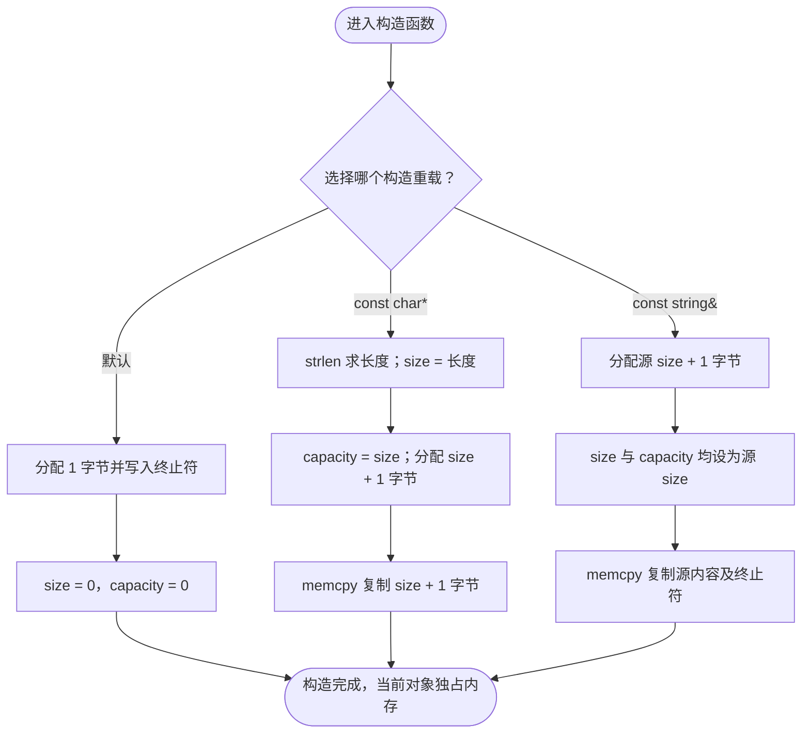

图省略了 `new[]` 抛出分配异常的出口；分配失败则构造不完成。类未声明移动构造和移动赋值；不要把拷贝行为解释为转移所有权。

### 4.2 拷贝赋值

赋值需要处理目标原有内存，所以不同于构造。先把新数据准备好，再释放旧内存，避免分配失败时破坏原对象。赋值后备用容量不会保留，而是变为源对象的长度。

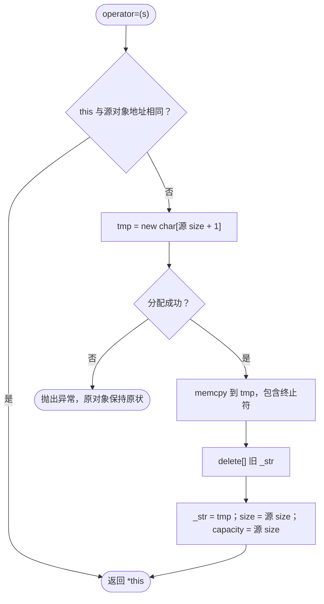

### 4.3 析构


清零是析构函数中的收尾操作，不意味着已经析构的对象可以继续使用。深拷贝保证正常使用中两个对象不会对同一块数组重复释放。

## 5. 访问与迭代器

`c_str()` 返回内部只读指针，`size()` 直接返回 `_size`。下标运算区分 const 与非 const 对象，但都先验证 `i < _size`；不能用这个接口访问末尾终止符。

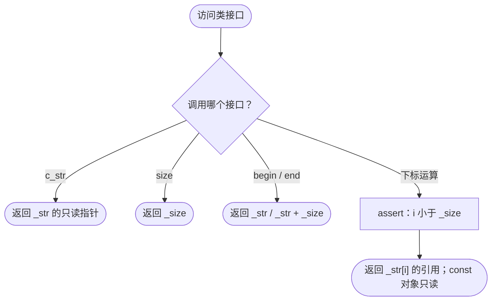

`assert` 是调试断言，定义 `NDEBUG` 后不会提供运行时边界保护。扩容、赋值或析构后，旧指针、引用和迭代器可能失效；插删即使未扩容，也会改变位置上的字符及尾后位置，应按需重新获取。修改有效字符时可以写入 `\0`，但这会使后续 C 字符串接口看到的长度与 `_size` 不一致。

## 6. 容量管理与尾部追加

### 6.1 reserve

`reserve(n)` 只在 `n > _capacity` 时重新分配，复制的是 `_size + 1` 字节，而不是整个旧容量。它不改变 `_size`，也不会初始化额外备用位置。

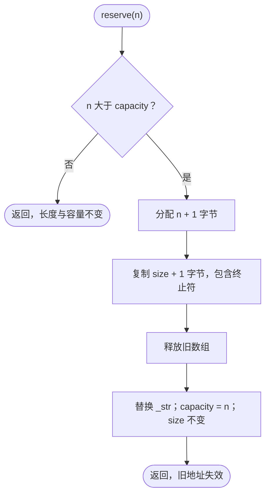

如分配失败，执行不会到达释放旧数组的步骤，原对象保持原状。容量增长不会自动防御 `n + 1` 等算术溢出。

### 6.2 push_back 与字符 +=

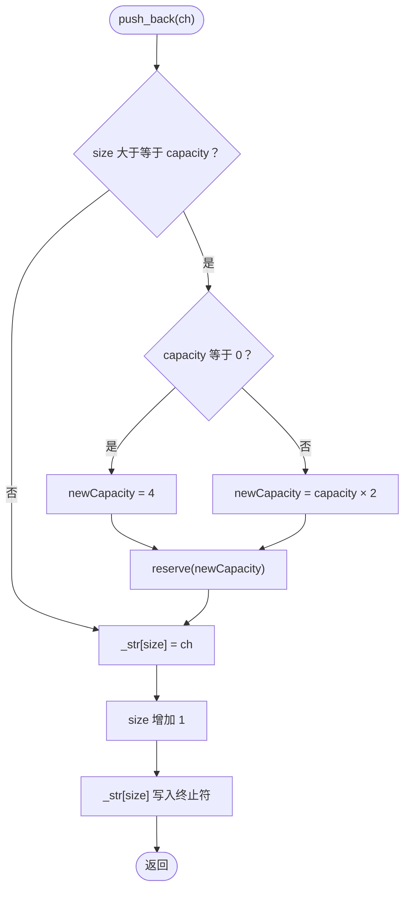

`operator+=(char)` 只调用 `push_back(ch)` 后返回 `*this`，因此支持连续追加。扩容采用倍增策略，连续尾插可以摊薄复制开销。

### 6.3 append 与字符串 +=

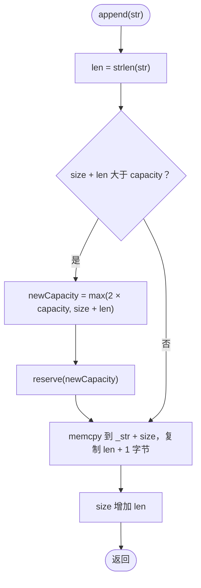

`operator+=(const char*)` 调用 `append(str)`，随后返回 `*this`。复制 `len + 1` 字节让新串在尾部自动带上终止符。输入指针必须与对象内部数组无别名关系；`s.append(s.c_str())` 不能作为可靠用法：扩容会释放输入指向的旧内存，不扩容时 `memcpy` 的源目标也可能重叠。

## 7. 插入

### 7.1 插入单个字符

允许 `pos == _size`，即尾插。搬移从后向前执行，连终止符一起右移一格，避免覆盖尚未搬走的字符。

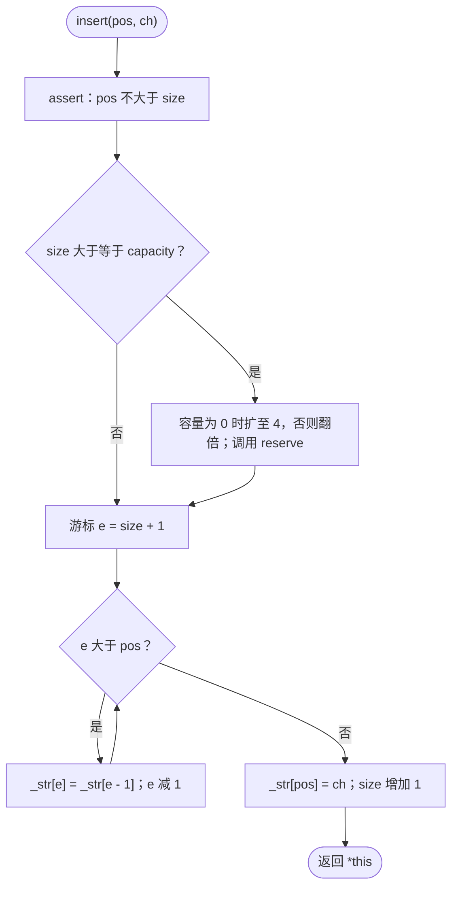

例如 `"abcd"` 在下标 2 插入 `'X'`：先依次搬动终止符、`d`、`c`，再写入 `X`，得到 `"abXcd"`。

### 7.2 插入 C 字符串：按现有代码展开

当前实现先留出 `len` 个位置，再逐字符复制输入串。搬移循环使用无符号下标减法，下图保留原条件；空输入时的回绕行为在图后说明。

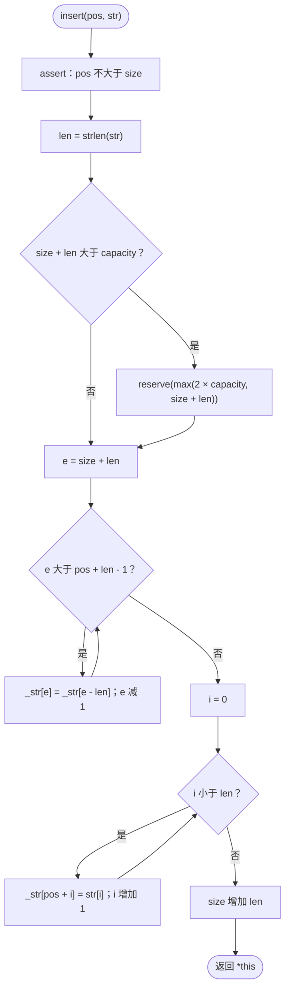

循环边界推演：`len > 0` 时，循环最后把原下标 `pos` 的字符搬到 `pos + len`，然后 `e` 减为 `pos + len - 1`，循环退出，头部插入也适用。`pos = 0, len = 0` 时，`pos + len - 1` 回绕为 `size_t` 最大值，搬移循环直接跳过，后续复制也跳过，实际为空操作。`pos > 0, len = 0` 时，搬移循环仅进行原位置自赋值，内容也不变。

这个回绕现象本身不等于越界，但表达式不利于阅读与维护。更实质的风险是输入指针引用内部存储时，扩容后悬空或搬移后源字符被改变，以及容量算术溢出。

对于正常的非别名输入，例如 `"abcd"` 在下标 2 插入 `"XY"`：搬动终止符、`d`、`c` 共 3 个字节，再写入 `XY`，得到 `"abXYcd"`。后续若改写实现，可用避免 `pos + len - 1` 的循环条件，并显式对空输入快速返回；本次不修改算法。

## 8. 删除与清空

### 8.1 erase

`erase` 的断言是 `pos < _size`，因此空串不能调用 `erase()`，非空串也不能传入尾后下标。`len == npos` 或长度覆盖整个后缀时，直接在 `pos` 截断；否则通过 `memmove` 左移剩余后缀。这里源与目标区间可能重叠，所以使用 `memmove`。

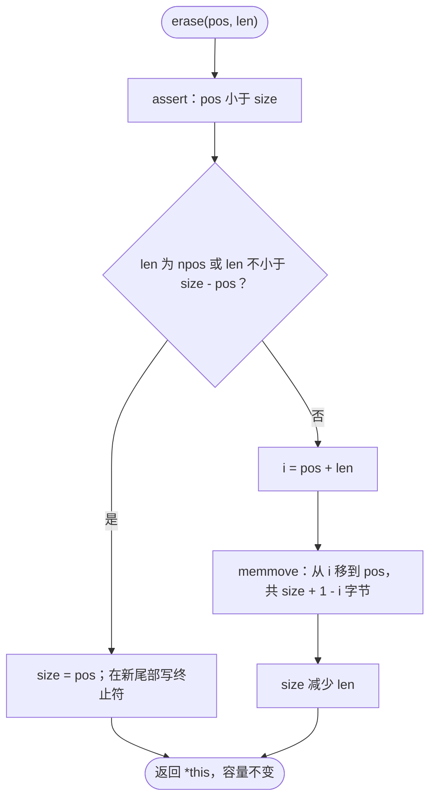

例如 `"abcdef".erase(2, 2)` 把 `"ef\0"` 移到下标 2，得到 `"abef"`；`erase(2)` 得到 `"ab"`；在合法 `pos` 上传入 `len = 0` 不改变内容。

### 8.2 pop_back 与 clear

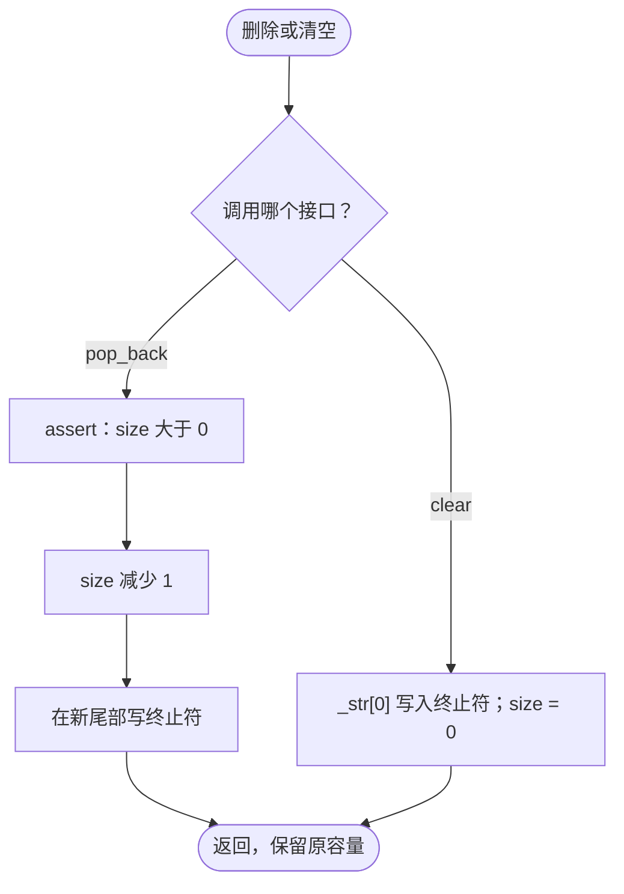

这些操作不释放内存，也不会抹掉全部旧字符；字符串的逻辑内容由长度和终止符确定。

## 9. 查找与子串

### 9.1 find(char, pos)

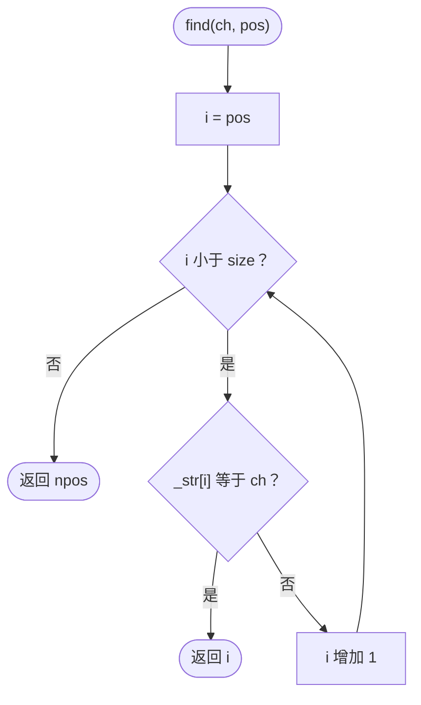

它不搜索末尾终止符；传入 `pos >= size` 会直接返回 `npos`。

### 9.2 find(const char*, pos)

```mermaid
flowchart TD
    start(["find(str, pos)"]) --> call["p = strstr(_str + pos, str)"]
    call --> match{"p 是空指针？"}
    match -->|"是"| missing(["返回 npos"])
    match -->|"否"| found(["返回 p - _str，即原串下标"])
```

这里没有范围断言或检查，调用者必须保证 `pos <= size`；不能照搬字符版对超大 `pos` 的行为。搜索空模式会返回起始下标 `pos`。`strstr` 在首个终止符处停止，所以不能跨越内嵌 `\0` 搜索。

### 9.3 substr

调用者应保证 `pos <= _size`。`len` 默认是 `npos`；超出剩余后缀长度时，裁剪到 `_size - pos`。新对象先预留容量，再逐字符尾插，最终返回独立副本。

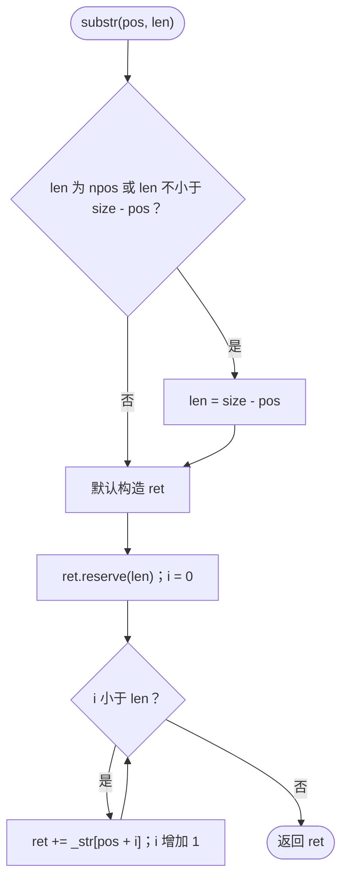

`pos == size` 时返回空对象；`pos > size` 会让无符号减法 `_size - pos` 回绕，后续可能越界访问。当前代码没有抛出越界异常的逻辑。

## 10. 比较运算

### 10.1 小于：逐字符比较后判断前缀

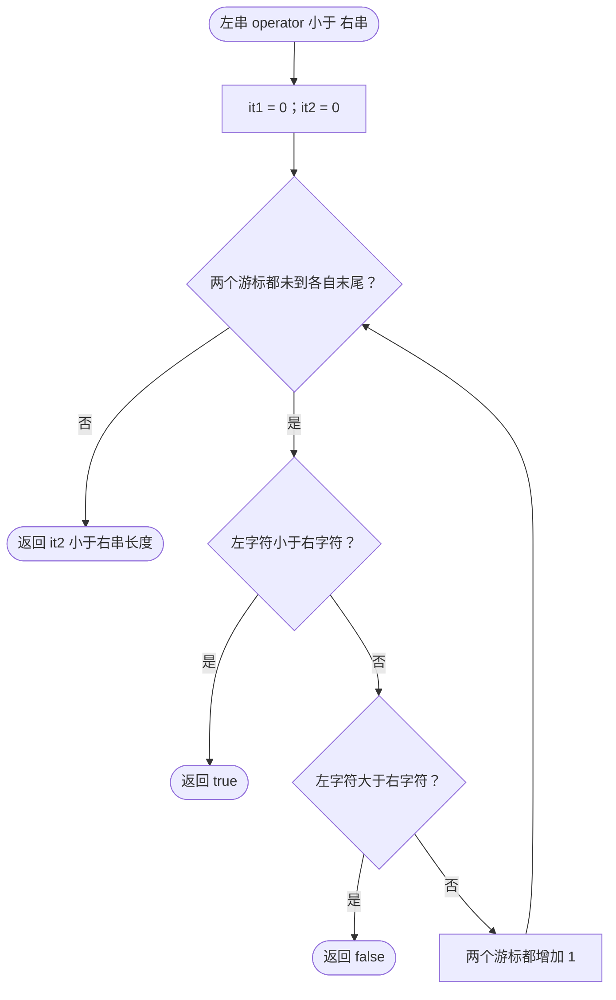

遇到第一个不同字符就能确定结果；共同前缀完全相同时，短串更小。空串小于非空串，相同字符串不小于自身。比较采用当前平台的 `char` 值规则，不是 Unicode 字符排序；中文 UTF-8 内容按字节处理。

### 10.2 等于与其余关系

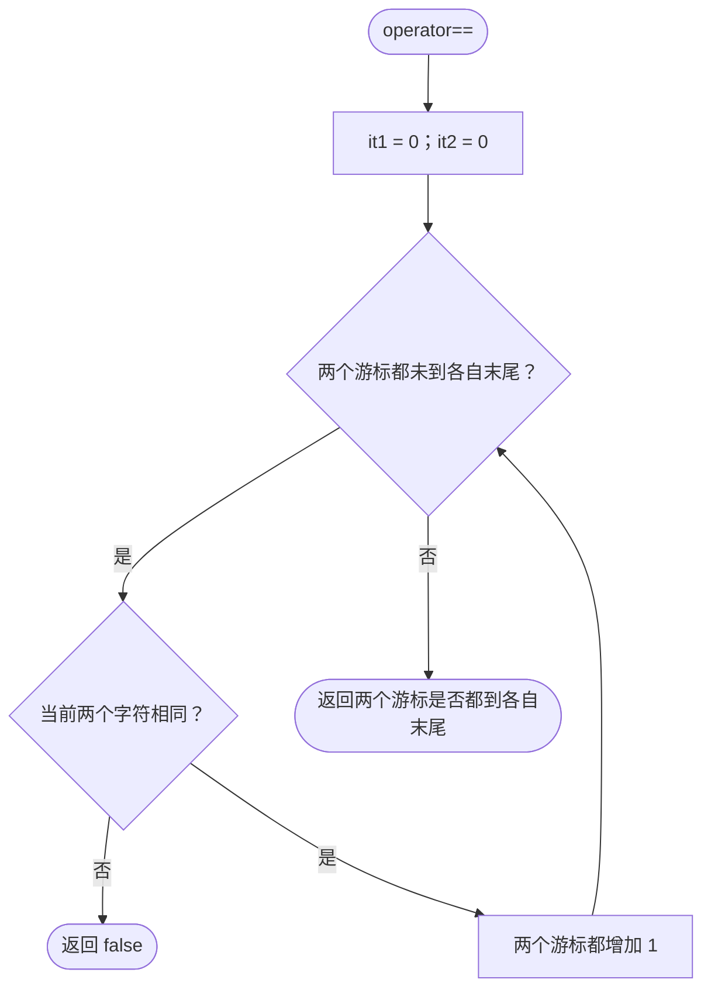

| 运算 | 实际复用表达式 |
| --- | --- |
| `a <= b` | `a < b || a == b`，有短路求值 |
| `a > b` | `!(a <= b)` |
| `a >= b` | `!(a < b)` |
| `a != b` | `!(a == b)` |

`==` 没有先比较长度，长度不同但有共同前缀时仍会遍历前缀。`<=` 在第一次比较为假时还可能再次遍历判等；整体最坏时间复杂度仍为线性。

## 11. 流输入输出

### 11.1 operator<<


此处没有按 `_size` 指定输出长度：如果有效字符中存在内嵌 `\0`，输出会提前停止。

### 11.2 operator>> 与 getline 的公共分块流程

两者都先清空对象，使用 `char buff[128]` 暂存字符；累计 127 个字符后写入终止符，通过 `operator+=` 和 `append` 追加整块；循环结束后追加不足一块的残留内容。

差别在停止条件：`operator>>` 检查空格或换行，`getline` 检查传入的 `delim`，默认是换行。两者在循环条件中都检查 `in.get(ch)` 的流状态。

**重要：当前循环体末尾还有一次 `ch = in.get()`。** 这次读取的结果在下一次条件中的 `in.get(ch)` 被覆盖，因此会吞掉字符，甚至吞掉本应终止输入的分隔符。下图准确保留了这一步。

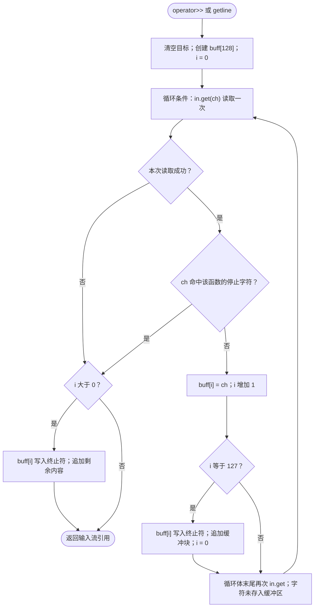

在没有更早命中停止字符的情况下，输入 `abcdef` 后到达 EOF，目前会保存 `ace`，丢掉 `bdf`。如果空格或分隔符恰好由循环体末尾那次读取取走，条件不会检查它，函数可能继续读取后续内容。

`operator>>` 不会先跳过前导空白，只把字面空格和换行当作停止字符；制表符没有被当作分隔符。停止字符若在条件中读到也已被消耗。不能把它当作标准 `std::string` 提取操作的等价实现。

如以后修复，应删除循环体末尾的重复读取，保留条件中的单次读取，并明确是否需要标准流的前导空白、EOF 状态及分隔符语义。本次保留原实现，只记录实际行为。

## 12. 当前边界问题与使用限制

| 位置 | 当前事实与影响 | 使用时的约束或后续修正方向 |
| --- | --- | --- |
| `operator>>`、`getline` | 条件和循环体各读取一次，导致隔字符丢失、漏检分隔符 | 后续应统一为每轮一次读取 |
| `append`、字符串 `insert` | 未处理输入指向自身数组的情况；扩容可能使源指针悬空，插入搬移可能改写源数据；追加还可能触发重叠 `memcpy` | 当前传入独立、有效的 C 字符串；后续考虑输入快照或偏移处理 |
| 字符串 `insert` | `pos + len - 1` 在 `pos == 0 && len == 0` 时无符号回绕，当前直接跳过搬移，通常表现为空操作 | 建议显式处理空输入、使用无需减 1 的循环边界 |
| `substr` | 没有检查 `pos <= size`；差值可回绕并导致越界读取 | 调用前自行校验起点 |
| 字符串 `find` | 直接使用 `_str + pos` 和 `strstr`，没有范围校验 | 要求 `pos <= size`，不要传 `npos` |
| `erase` | 断言使用严格小于；空串以及 `pos == size` 均不满足前提 | 清空可调用 `clear()`；不要按标准库接口边界套用 |
| `operator[]`、`insert`、`erase`、`pop_back` | 依赖断言；Release 下通常没有检查 | 必须遵守各接口前置条件，断言不是异常机制 |
| 接收 `const char*` 的接口 | `strlen` / `strstr` 不处理空指针及缺少终止符的数组 | 参数必须非空、有效、终止正确 |
| 容量计算 | `size + len`、`2 * capacity`、`n + 1` 没有溢出检查 | 超大输入尚无可靠保护，后续需要长度上限与溢出校验 |
| 内嵌终止符 | 长度、遍历、比较可以覆盖内嵌 `\0`；输出、`strlen`、`strstr` 则按首个终止符截断 | 当前更适用于普通文本，接口不统一支持二进制内容 |
| 字符编码 | 长度与位置按 `char` 字节计算 | UTF-8 汉字可能占多个字节，不能把下标当作汉字序号 |
| 类型命名与特性 | 全局 `string` 容易与 `std::string` 混淆；没有移动操作、公开容量查询等接口 | 示例中使用明确类型限定；学习实现不等同于标准库完整功能 |

本文的流程图用于理解实现、检查循环和边界；源码整理只改变文件位置及构建方式，未修复或扩展上述算法行为。
