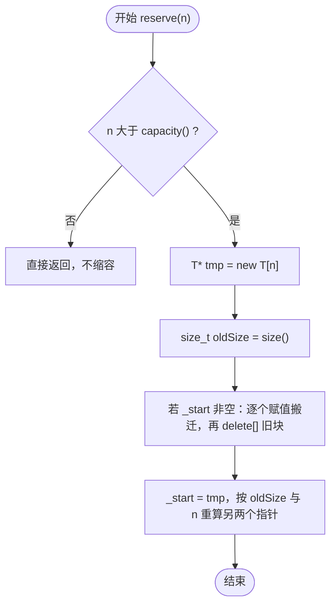
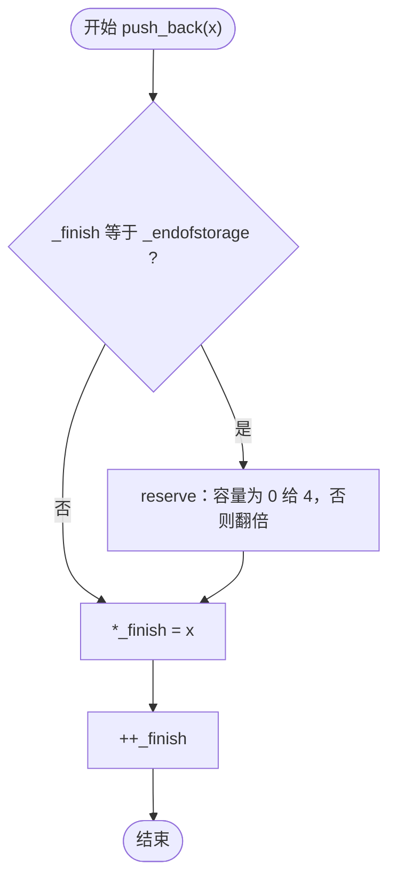

# XiYue::vector 实现流程图

依据 `example/vector.h` 的实际代码绘制，只描述容器自身的成员函数，不含 `main.cpp` 的演示流程。

图例：圆角框 = 开始 / 结束，矩形 = 处理步骤，菱形 = 判断。

## 目录

1. [三指针模型](#1-三指针模型)
2. [reserve](#2-reserven)
3. [push_back](#3-push_backconst-t-x)
4. [insert](#4-insertiterator-pos-size_t-n-const-t-x)
5. [erase](#5-erase)
6. [pop_back](#6-pop_back)
7. [速查](#7-速查)

## 1. 三指针模型

整个容器只有三个成员，全部是指针。所有操作最终都归结为移动这三个指针。

```text
      _start            _finish              _endofstorage
        │                 │                       │
        ▼                 ▼                       ▼
     ┌─────┬─────┬─────┬─────┬─────┬─────┐
     │  1  │  2  │  3  │ 空  │ 空  │ 空  │
     └─────┴─────┴─────┴─────┴─────┴─────┘
     └──── size() ────┘
     └──────────── capacity() ────────────┘
```

| 成员 / 接口 | 含义 |
| --- | --- |
| `_start` | 存储块首地址，等于 `begin()` |
| `_finish` | 最后一个元素的下一个位置，等于 `end()` |
| `_endofstorage` | 整块存储的末尾，`_endofstorage - _start` 即容量 |
| `size()` | `_finish - _start`，指针相减，O(1) |
| `capacity()` | `_endofstorage - _start` |
| `empty()` | `_start == _finish` |

不变式：任何时刻都满足 `_start <= _finish <= _endofstorage`，且 `size() <= capacity()`。构造函数把三者都置为 `nullptr`，得到 size 与 capacity 均为 0 的空容器。

## 2. reserve(n)

只在 `n > capacity()` 时才真正做事，所以它是"只增不减"的。



要点：

- `oldSize` 必须在改 `_start` 之前取。一旦 `_start` 变成 `tmp`，`size()` 就成了两个不相干内存相减，结果没有意义。
- 搬迁用循环逐个赋值，**不能用 `memcpy`**：`T` 可能是 `std::string` 这类带资源的类型，按字节拷贝会得到两个指向同一份资源的对象，析构时二次释放。
- `new T[n]` 会把 n 个位置全部构造（默认构造），这是本实现"槽位永远处于已构造状态"的根源。
- 整个过程不改变 `size()`，只改变 `capacity()`。

## 3. push_back(const T& x)



要点：

- 扩容策略是 `capacity() == 0 ? 4 : capacity() * 2`，即 0 → 4 → 8 → 16，几何增长保证均摊 O(1)。
- 写元素用的是赋值 `*_finish = x`，因为这些位置已在 `new T[n]` 时构造好。
- 只有 `_finish` 前进；`_endofstorage` 只在 `reserve` 里改。

## 4. insert(iterator pos, size_t n, const T& x)

全类最复杂的函数：先保证空间够，再把插入点之后的内容整体后移，最后填充。


### 4.1 扩容分支


要点：

- **为什么先算 offset**：`reserve` 会 `delete[]` 旧块，传进来的裸指针 `pos` 指向已释放的内存。下标是相对量，扩容后仍能还原位置。
- **为什么一次扩到够**：用 `while` 倍增到不小于 `size() + n`，否则一次插 n 个可能连续搬好几次，退化成平方级。
- **为什么从后往前搬**：从前往后写会把还没搬的元素提前覆盖。代码用下标 `_start[offset + i - 1 + n] = _start[offset + i - 1]`，循环变量从 count 递减。
- 单元素版 `insert(pos, x)` 直接 `return insert(pos, 1, x);`，不重复写循环。
- `pos` 允许等于 `_finish`，此时 count 为 0，等价于尾部插入。

## 5. erase

### 5.1 erase(iterator first, iterator last)：区间版


要点：

- **空区间必须提前返回**：若照常往下走，循环一次都不执行，`dst` 仍等于 `first`，随后 `_finish = dst` 会把 `first` 之后全部截掉。而 `erase(end(), end())` 本身是合法的。
- 前移用 `for (T* src = last; src < _finish; ++src, ++dst) *dst = *src;`，从前往后，因为目标在源的前面。
- 返回值是 `first`，即被删区间之后的第一个元素现在的位置；删到尾部时它恰好等于新的 `end()`。

### 5.2 erase(iterator pos)：单元素版


单元素版只多一句断言：`pos` 不能等于 `end()`，因为那里没有元素可删。其余逻辑全部复用区间版。

## 6. pop_back()


要点：

- 不返回被删除的元素（与标准库一致）。需要保留时先读 `back()` 或 `v[v.size() - 1]`。
- 这里**不析构元素**，只回退指针。因为槽位是 `new T[n]` 一次性构造的，统一由 `delete[]` 析构；若在此单独析构，槽位会退回"未构造"状态，之后再赋值就是未定义行为。
- 代价：被弹出元素占用的资源（如 `string` 的堆缓冲）要等槽位被重新赋值或整个容器析构时才释放。
- 容量不变，因此 `pop_back` 之后容器仍可立即复用同一块存储。

## 7. 速查

| 接口 | 是否改 size | 是否改 capacity | 时间复杂度 |
| --- | --- | --- | --- |
| `push_back` | +1 | 满时翻倍 | 均摊 O(1)，扩容时 O(n) |
| `pop_back` | -1 | 不变 | O(1) |
| `insert(pos, n, x)` | +n | 不够时倍增 | O(n + 后移元素数) |
| `erase(first, last)` | 减去区间长度 | 不变 | O(前移元素数) |
| `erase(pos)` | -1 | 不变 | O(n - pos) |
| `reserve(n)` | 不变 | n 大于当前容量时增大 | 重新分配时 O(n) |
| `operator[]` | 不变 | 不变 | O(1)，仅断言检查下标 |

| 实现上的三个约定 | 原因 |
| --- | --- |
| 槽位一律由 `new T[n]` 统一构造、`delete[]` 统一析构 | 简化实现，代价是 `pop_back` / `erase` 不立即释放元素资源 |
| 搬迁用循环赋值，不用 `memcpy` | 元素可能自带资源，按字节拷贝会导致重复释放 |
| 所有"位置"在扩容前先转成下标 | 扩容会换内存，裸指针立即失效；下标是相对量，不受影响 |

---

绘制依据：`example/vector.h`（`XiYue::vector<T>`）。范围限定：只描述容器自身的成员函数，不包含 `main.cpp` 的演示流程。
