# XiYue::vector 实现流程图

依据 `example/vector.h` 的实际代码绘制，只描述容器自身的成员函数，不含 `main.cpp` 的演示流程。

图例：圆角框 = 开始 / 结束，矩形 = 处理步骤，菱形 = 判断。

## 目录

1. [三指针模型](#1-三指针模型)
2. [构造家族](#2-构造家族)
3. [析构函数](#3-析构函数)
4. [reserve](#4-reserven)
5. [push_back](#5-push_backconst-t-x)
6. [insert](#6-insertiterator-pos-size_t-n-const-t-x)
7. [erase](#7-erase)
8. [pop_back](#8-pop_back)
9. [clear](#9-clear)
10. [resize](#10-resizen-value)
11. [拷贝构造](#11-拷贝构造)
12. [移动构造与赋值](#12-移动构造与赋值)
13. [速查](#13-速查)

## 1. 三指针模型

整个容器只有三个成员，全部是指针。所有操作最终都归结为移动这三个指针。

```text
      _start            _finish              _endofstorage
        │                 │                       │
        ▼                 ▼                       ▼
     ┌─────┬─────┬─────┬─────┬─────┬─────┐
     │  1  │  2  │  3  │ 空  │ 空  │ 空  │
     └─────┴─────┴─────┴─────┴─────┴─────┘
     └──── size() ────┘
     └──────────── capacity() ────────────┘
```

| 成员 / 接口 | 含义 |
| --- | --- |
| `_start` | 存储块首地址，等于 `begin()` |
| `_finish` | 最后一个元素的下一个位置，等于 `end()` |
| `_endofstorage` | 整块存储的末尾，`_endofstorage - _start` 即容量 |
| `size()` | `_finish - _start`，指针相减，O(1) |
| `capacity()` | `_endofstorage - _start` |
| `empty()` | `_start == _finish` |

不变式：任何时刻都满足 `_start <= _finish <= _endofstorage`，且 `size() <= capacity()`。

三个成员在类内直接给了 `= nullptr`（就地初始化），所以 `vector() = default` 生成出来的默认构造函数也是安全的；如果只写 `= default` 而不给初值，三个指针就是随机值，`size()` 一算就崩。

## 2. 构造家族

同一个 `vector` 有六个入口，选谁由实参形态决定。

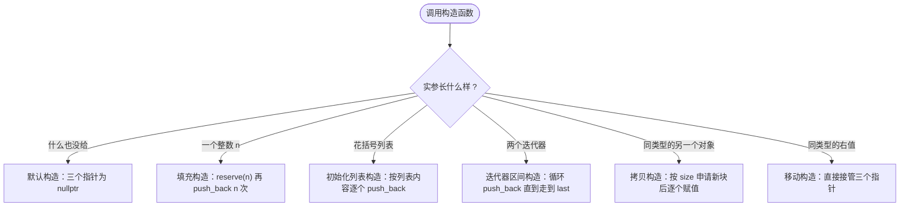

| 写法 | 走哪一个 | 结果 |
| --- | --- | --- |
| `vector<int> v;` | 默认构造 | `size=0 cap=0` |
| `vector<int> v(5);` | 填充构造，`value` 取 `T()` | 5 个 0 |
| `vector<int> v(5, 10);` | 填充构造 | 5 个 10 |
| `vector<int> v{1, 2, 3};` | 初始化列表构造 | 3 个元素 |
| `vector<int> v(arr, arr + 3);` | 迭代器区间构造 | 3 个元素 |
| `vector<int> v(other);` | 拷贝构造 | 深拷贝，容量等于 `other.size()` |
| `vector<int> v(std::move(other));` | 移动构造 | 接管指针，源变空 |

### 2.1 填充构造 vector(n, value)

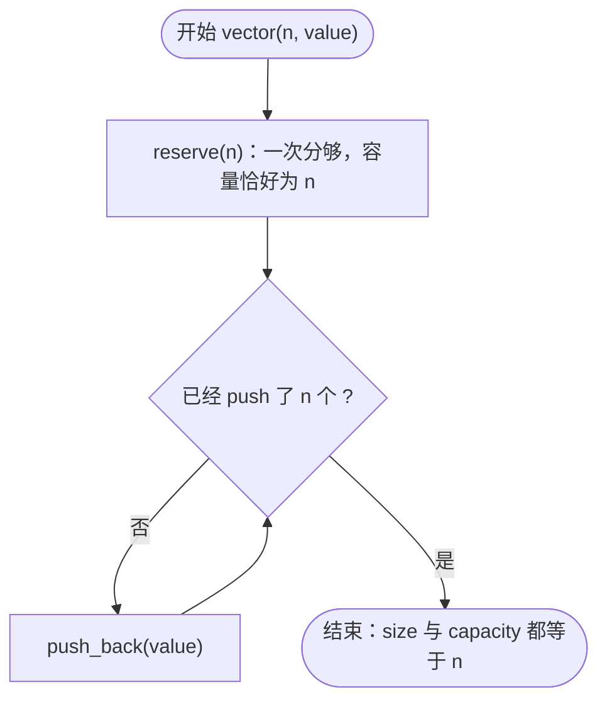

要点：

- 带 `explicit`，所以 `vector<int> v = 5;` 编译不过（标准库的 `vector(n)` 同样如此）。
- 两个重载（`vector(n)` 与 `vector(n, value)`）用默认参数合成一个，`value` 缺省时取 `T()`。
- `reserve(n)` 已经把容量撑到 n，循环里的 `push_back` 不会触发扩容，所以是 n 次赋值而不是 n 次搬迁。

### 2.2 初始化列表构造

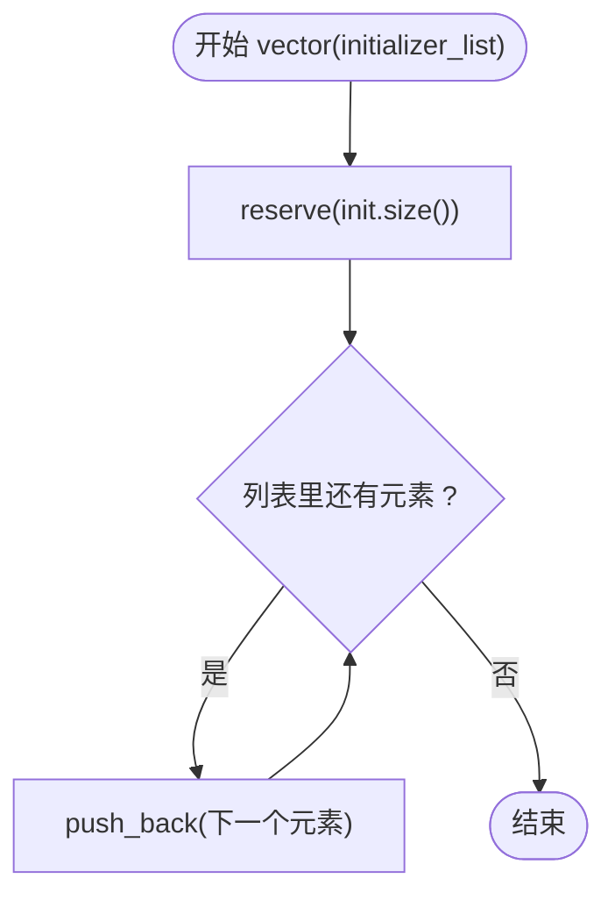

要点：

- 不能加 `explicit`，否则 `vector<int> v = {1, 2, 3};` 用不了。
- **有了它，`{}` 会优先匹配这里**：`v{5}` 是「1 个元素 5」，而 `v(5)` 是「5 个 0」。圆括号表示数量，花括号表示内容。
- `v{}` 走的是空列表版本，不是默认构造；结果都是空容器，但调用的是不同函数。

### 2.3 迭代器区间构造

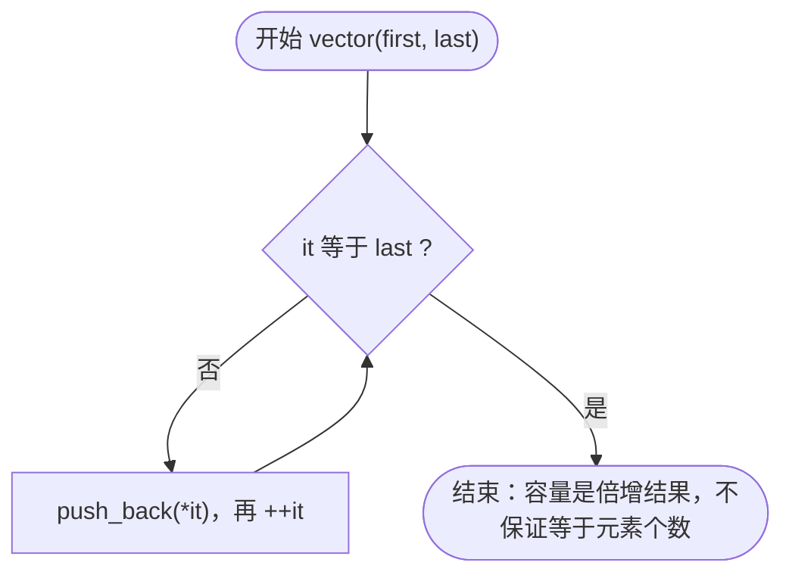

要点：

- 第二个模板参数 `enable_if<!is_integral<InputIt>>` 把整数类型排除掉。没有它，`vector<int> v(5, 10)` 会优先匹配本模板（`int, int` 完全匹配），把 5 当成迭代器去解引用。
- 不预先数距离再 `reserve`，因为那要遍历两遍，单遍迭代器（如流迭代器）第二遍就空了。代价是容量是倍增的结果：3 个元素得到 `cap=4`，标准库会给 `cap=3`。
- 能接受 `T*`、`const T*`、`std::vector` / `std::list` 的迭代器，因为它们都满足 `*it`、`++it`、`it != last` 这套最小接口。

## 3. 析构函数

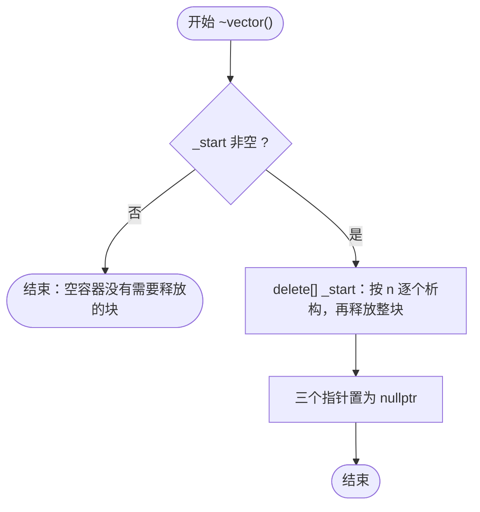

要点：

- `new T[n]` 会记住 n，`delete[]` 按这个 n 逐个调用析构函数——n 正好是当初构造出来的槽位数，一个不多一个不少。
- **绝对不能再手动析构元素**：同一批对象会被析构两次。
- 这也解释了 `pop_back` / `erase` / `clear` 为什么不析构元素——它们的账都记在这一个 `delete[]` 上。
- `delete[] nullptr` 本身是合法的空操作，代码里的 `if (_start)` 只是让流程更直白。

## 4. reserve(n)

只在 `n > capacity()` 时才真正做事，所以它是"只增不减"的。


要点：

- `oldSize` 必须在改 `_start` 之前取。一旦 `_start` 变成 `tmp`，`size()` 就成了两个不相干内存相减，结果没有意义。
- 搬迁用循环逐个赋值，**不能用 `memcpy`**：`T` 可能是 `std::string` 这类带资源的类型，按字节拷贝会得到两个指向同一份资源的对象，析构时二次释放。
- `new T[n]` 会把 n 个位置全部构造（默认构造），这是本实现"槽位永远处于已构造状态"的根源。
- 整个过程不改变 `size()`，只改变 `capacity()`。

## 5. push_back(const T& x)


要点：

- 扩容策略是 `capacity() == 0 ? 4 : capacity() * 2`，即 0 → 4 → 8 → 16，几何增长保证均摊 O(1)。
- 写元素用的是赋值 `*_finish = x`，因为这些位置已在 `new T[n]` 时构造好。
- 只有 `_finish` 前进；`_endofstorage` 只在 `reserve` 里改。

## 6. insert(iterator pos, size_t n, const T& x)

全类最复杂的函数：先保证空间够，再把插入点之后的内容整体后移，最后填充。

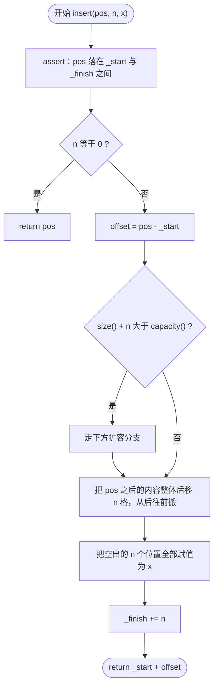

### 6.1 扩容分支


要点：

- **为什么先算 offset**：`reserve` 会 `delete[]` 旧块，传进来的裸指针 `pos` 指向已释放的内存。下标是相对量，扩容后仍能还原位置。
- **为什么一次扩到够**：用 `while` 倍增到不小于 `size() + n`，否则一次插 n 个可能连续搬好几次，退化成平方级。
- **为什么从后往前搬**：从前往后写会把还没搬的元素提前覆盖。代码用下标 `_start[offset + i - 1 + n] = _start[offset + i - 1]`，循环变量从 count 递减。
- 单元素版 `insert(pos, x)` 直接 `return insert(pos, 1, x);`，不重复写循环。
- `pos` 允许等于 `_finish`，此时 count 为 0，等价于尾部插入。
- 已知限制：`v.insert(v.begin(), v[2])` 这种自引用插入会读到错值（扩容释放旧块、后移又覆盖），需要时先 `T copy = v[2];` 再插入。

## 7. erase

### 7.1 erase(iterator first, iterator last)：区间版

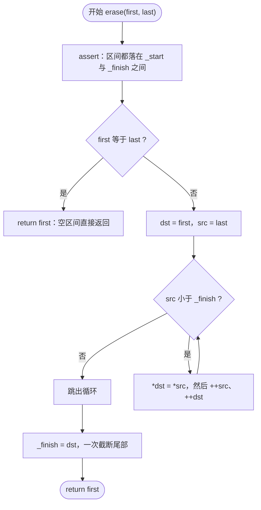

要点：

- **空区间必须提前返回**：若照常往下走，循环一次都不执行，`dst` 仍等于 `first`，随后 `_finish = dst` 会把 `first` 之后全部截掉。而 `erase(end(), end())` 本身是合法的。
- 前移用 `for (T* src = last; src < _finish; ++src, ++dst) *dst = *src;`，从前往后，因为目标在源的前面。
- 返回值是 `first`，即被删区间之后的第一个元素现在的位置；删到尾部时它恰好等于新的 `end()`。
- 被"移出"的尾部槽位不析构（同 `pop_back`），资源等复用或整块释放时回收。

### 7.2 erase(iterator pos)：单元素版

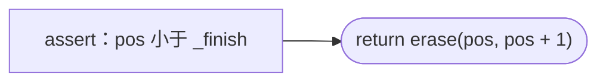

单元素版只多一句断言：`pos` 不能等于 `end()`，因为那里没有元素可删。其余逻辑全部复用区间版。

## 8. pop_back()

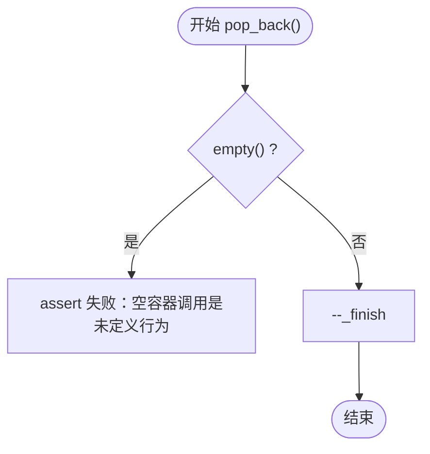

要点：

- 不返回被删除的元素（与标准库一致）。需要保留时先读 `v[v.size() - 1]`。
- 这里**不析构元素**，只回退指针。因为槽位是 `new T[n]` 一次性构造的，统一由 `delete[]` 析构；若在此单独析构，槽位会退回"未构造"状态，之后再赋值就是未定义行为。
- 代价：被弹出元素占用的资源（如 `string` 的堆缓冲）要等槽位被重新赋值或整个容器析构时才释放。
- 容量不变，因此 `pop_back` 之后容器仍可立即复用同一块存储。

## 9. clear()

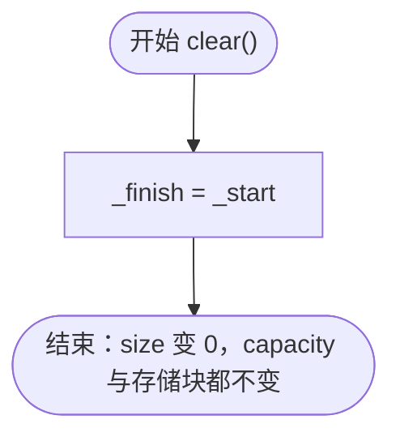

要点：

- 一行足够：元素个数就是 `_finish - _start`，让两者重合，size 立刻归零。
- **O(1)**，而标准库的 `clear()` 是 O(n)——它要逐个析构，本实现不析构（原因同 `pop_back`）。
- 空容器时 `_start` 与 `_finish` 同为 `nullptr`，赋完仍是空容器，不需要特判。
- 清空后 `begin() == end()`，存储块没被释放，可以继续 `push_back` 复用。

## 10. resize(n, value)

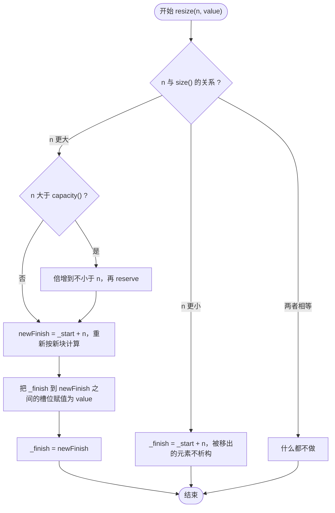

要点：

- 扩容**按倍增**而不是 `reserve(n)`：若只扩到 n，`for (...) v.resize(v.size() + 1);` 每次都要重新分配，退化成 O(n²)。
- `newFinish` 必须在 `reserve` 之后算，因为扩容换了内存——和 `insert` 里 `pos = _start + offset` 是同一个道理。
- 补齐用的是赋值 `*p = value`，槽位早已构造好；`value` 缺省时取 `T()`，所以 `resize(n)` 要求 `T` 可默认构造。
- 缩小时只回退 `_finish`，不析构、不缩容。复杂度 O(|n - size|)，外加可能的 O(n) 搬迁。

## 11. 拷贝构造

容器持有裸指针，所以必须自己写拷贝构造。编译器生成的版本只做"逐成员拷贝"——三个指针照抄，两个对象指向同一块内存，析构时同一块内存被 `delete[]` 两次。

### 11.1 两种写法

**写法 A**（当前采用）：按元素个数申请，逐个赋值。

```cpp
size_t n = other.size();
if (n > 0)
{
    _start = new T[n];
    for (size_t i = 0; i < n; ++i)
    {
        _start[i] = other._start[i];
    }
    _finish = _start + n;
    _endofstorage = _start + n;
}
```

**写法 B**（注释里保留的对照）：先按对方的容量预留，再用 `push_back` 一个个塞进去。

```cpp
reserve(other.capacity());
for (auto& e : other)
{
    push_back(e);
}
```

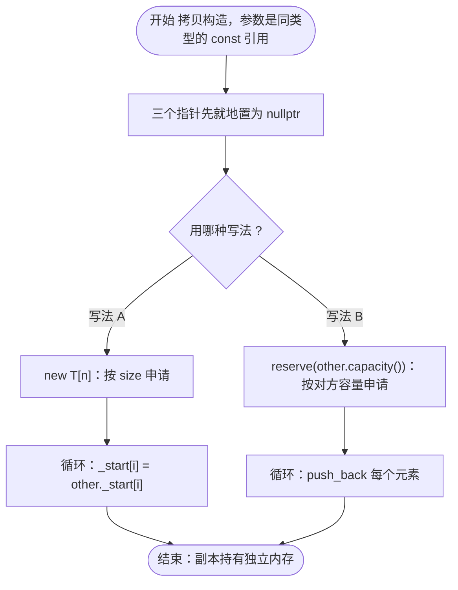

### 11.2 区别在哪里

| 对比项 | 写法 A | 写法 B |
| --- | --- | --- |
| 副本的容量 | 等于 `other.size()` | 等于 `other.capacity()`，可能远大于 size |
| 元素怎么落地 | 直接对已构造的槽位赋值 | 走 `push_back`：判容量 → 赋值 → `++_finish` |
| 每次循环的开销 | 一次赋值 | 一次比较 + 一次赋值 + 一次自增 |
| 代码量与复用 | 自己写全，与 `push_back` 的逻辑重复 | 复用 `push_back`，它将来改了这里自动跟随 |
| 中途抛异常 | 已申请的块没人释放（泄漏） | 同样泄漏 |
| 对 `T` 的要求 | 可默认构造 + 可赋值 | 同左 |

三点展开：

**① 只有"容量"是行为上的真区别。**

```text
a : size=1 cap=1000      原件只放 1 个元素，却预留了 1000 的容量
b : size=1 cap=1000      写法 B 的副本跟着分配 1000 个槽
```

写法 A 的副本是 `cap == size == 1`。容量是原件的"预留"，不是它的"内容"，拷大对象（`std::string`、大结构体）时这个放大是实打实的内存。

**② 写入方式不同，但结果一样。**

A 的 `_start[i] = other._start[i]` 和 B 的 `push_back(e)`，最终都是"给已构造的槽位赋值"——因为 `new T[n]` 早把槽位都构造好了。B 多出来的开销（每轮判一次容量）在预留够用的情况下只是几次比较，可以忽略。

**③ 异常安全不是区别，两者有同样的漏洞。**

- A：`new T[n]` 之后若某次赋值抛异常，`_start` 泄漏；
- B：`reserve` 之后若某次 `push_back` 抛异常，同样泄漏。

因为对象构造没完成，析构函数不会执行。哪种写法都要自己兜：

```cpp
catch (...)
{
    delete[] _start;
    _start = _finish = _endofstorage = nullptr;
    throw;
}
```

### 11.3 怎么选

| 想要 | 选 |
| --- | --- |
| 副本内存最省、逻辑最直白 | 写法 A（按 `size` 申请） |
| 代码最短、分配逻辑只维护一份 | 写法 B，把 `capacity()` 换成 `size()` 就能兼顾内存 |

两种写法都要求 `T` 可默认构造，因为最终都走 `new T[n]`。

## 12. 移动构造与赋值

三法则的三个函数之外，这一组让容器能"偷"资源而不是"复制"资源。

### 12.1 移动构造 vector(vector&& other)

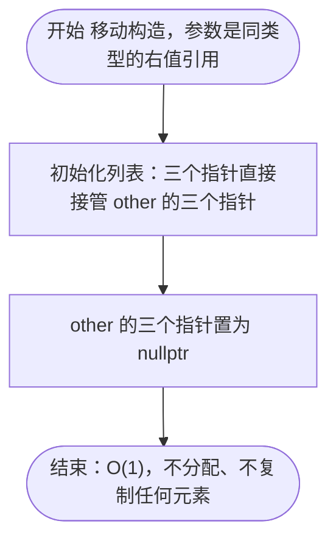

要点：

- 标 `noexcept` 不只是修饰：容器扩容搬迁元素时，只有"移动构造 noexcept"才会优先移动，否则退回拷贝。本类被放进 `std::vector` 时，这一点决定了外层扩容是接指针还是重新分配。
- 被移走的源对象处于"有效但为空"的状态，可以继续 `push_back`，但不要假设它保留原值。

### 12.2 swap(vector& other)

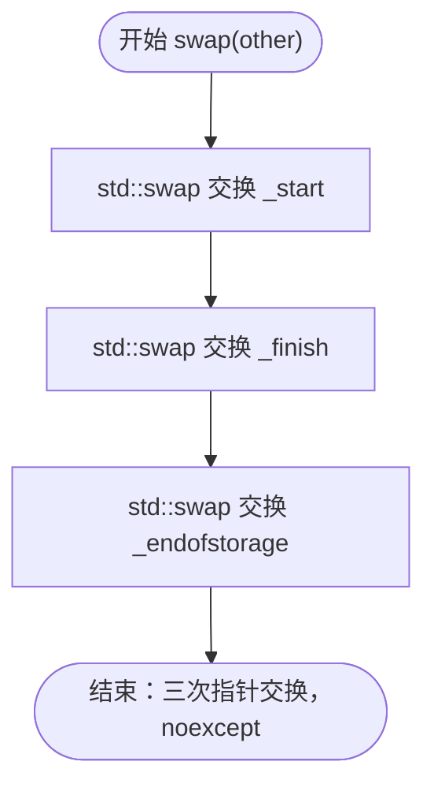

要点：

- 交换的是**三个指针**，不是整个对象。`std::swap` 收到的是 `T*`，只做指针赋值，不会反过来调到 `operator=`。
- **不能写 `std::swap(*this, other)`**：`std::swap` 的通用版内部是"移动构造 + 两次移动赋值"，而移动赋值里又调用 `swap`，会直接无限递归到栈溢出。
- 另有一个非成员 `XiYue::swap(vector&, vector&)` 只是转发给成员版。调用侧写 `using std::swap; swap(a, b);`，ADL 会优先选中它，`std::sort` 这类泛型算法也走这条路。

### 12.3 operator=(vector other)

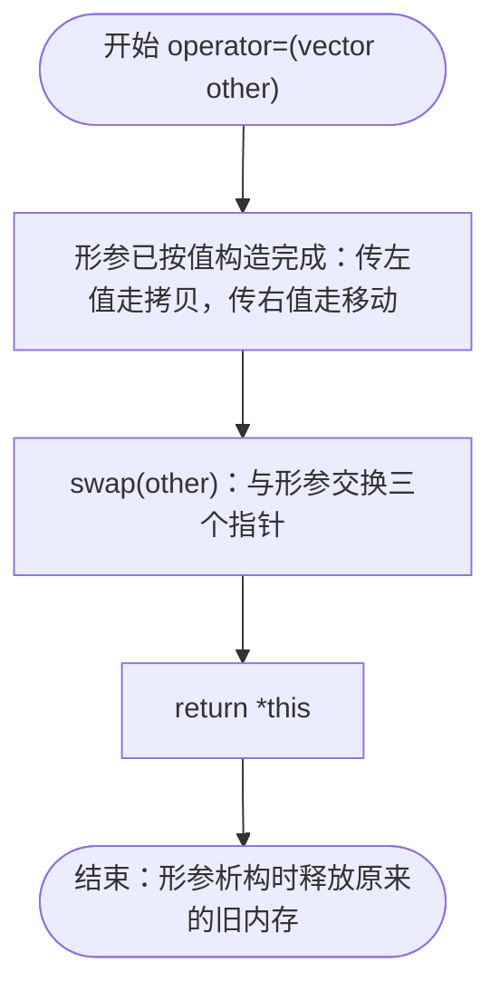

要点：

- 一个函数同时顶替拷贝赋值和移动赋值，因为"拷贝还是移动"发生在**进入函数之前**（构造形参时）。
- **自赋值天然安全**：`a = a` 时形参是一份副本，交换自己和副本没有任何问题，不需要 `if (this == &other)`。
- **不用手写 `delete[]`**：交换后旧指针在形参手里，形参析构时自动释放，所以"先释放还是先拷贝"的顺序问题不存在。
- **强异常保证**：拷贝发生在进函数前，一旦抛异常 `*this` 一点没动；函数体内的 `swap` 是 `noexcept`，不会失败。
- 不标 `noexcept`：构造形参那一步仍可能抛（`new` 失败、元素拷贝失败），标上会误导。

## 13. 速查

| 接口 | 是否改 size | 是否改 capacity | 时间复杂度 |
| --- | --- | --- | --- |
| `vector()` | 0 | 0 | O(1) |
| `vector(n, value)` | +n | 恰好 n | O(n) |
| `vector(initializer_list)` | +列表长度 | 恰好列表长度 | O(n) |
| `vector(first, last)` | +区间长度 | 倍增结果 | O(n)，含扩容搬迁 |
| 拷贝构造 | 同源 | 等于源的 size | O(n) |
| 移动构造 | 接管源的 size | 接管源的 capacity | O(1) |
| `operator=` | 同源 | 同源 | 拷贝 O(n)，移动 O(1) |
| `swap` | 互换 | 互换 | O(1)，`noexcept` |
| `push_back` | +1 | 满时翻倍 | 均摊 O(1)，扩容时 O(n) |
| `pop_back` | -1 | 不变 | O(1) |
| `insert(pos, n, x)` | +n | 不够时倍增 | O(n + 后移元素数) |
| `erase(first, last)` | 减去区间长度 | 不变 | O(前移元素数) |
| `erase(pos)` | -1 | 不变 | O(n - pos) |
| `clear` | 归零 | 不变 | O(1) |
| `resize(n, value)` | 变成 n | 不够时倍增 | O(\|n - size\|)，可能加 O(n) 搬迁 |
| `reserve(n)` | 不变 | n 大于当前容量时增大 | 重新分配时 O(n) |
| `operator[]` | 不变 | 不变 | O(1)，仅断言检查下标 |

| 实现上的约定 | 原因 |
| --- | --- |
| 槽位一律由 `new T[n]` 统一构造、`delete[]` 统一析构 | 简化实现，代价是 `pop_back` / `erase` / `clear` 不立即释放元素资源 |
| 搬迁用循环赋值，不用 `memcpy` | 元素可能自带资源，按字节拷贝会导致重复释放 |
| 所有"位置"在扩容前先转成下标 | 扩容会换内存，裸指针立即失效；下标是相对量，不受影响 |
| 缩容类操作只回退 `_finish` | 槽位仍处于已构造状态，之后可直接赋值复用 |
| 赋值走"按值传参 + swap" | 自赋值、旧内存释放、异常安全三件事一并解决 |

---

绘制依据：`example/vector.h`（`XiYue::vector<T>`）。范围限定：只描述容器自身的成员函数，不包含 `main.cpp` 的演示流程。
